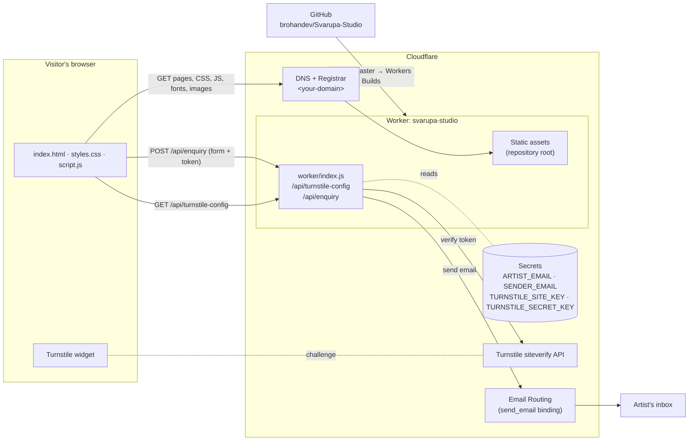
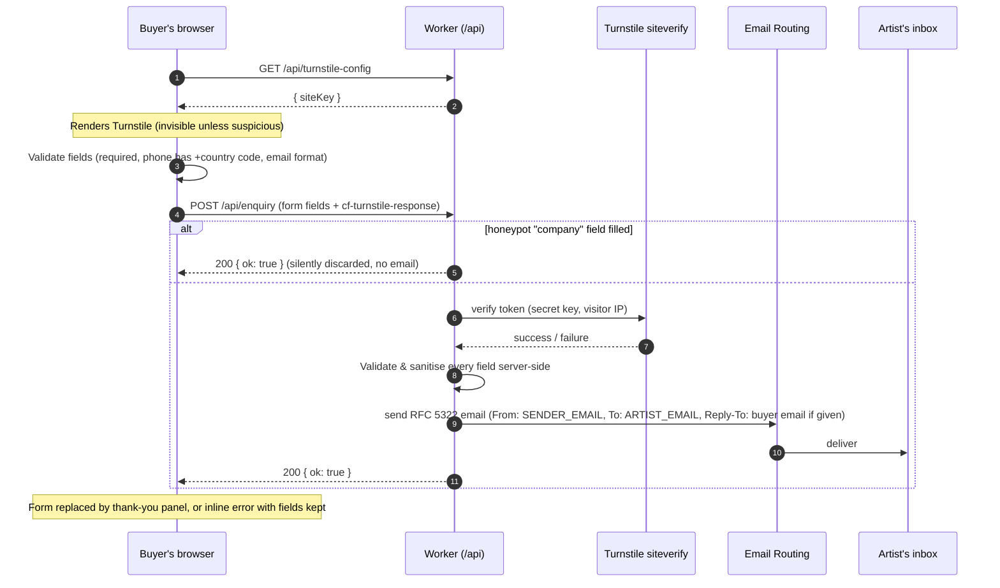

# Svarupa Studio

Storefront for **Ruma Dev**, a Singapore-based contemporary artist whose paintings draw on the *Mahabharata* and *Ramayana*. The site presents the collection, introduces the artist, and takes private commission enquiries, which are emailed to the artist.

- **Production:** `https://<your-domain>` (custom domain registered through Cloudflare)
- **Workers preview URL:** https://svarupa-studio.rohan-returns.workers.dev
- **Repository:** https://github.com/brohandev/Svarupa-Studio

> Throughout this README, `<your-domain>` stands for the studio's production domain. Replace it with the real domain when following the steps.

---

## Contents

1. [Getting started (local development)](#1-getting-started-local-development)
2. [Solution architecture](#2-solution-architecture)
3. [Deployment guide (Cloudflare)](#3-deployment-guide-cloudflare)
4. [Day-to-day maintenance](#4-day-to-day-maintenance)
5. [Troubleshooting](#5-troubleshooting)

---

## 1. Getting started (local development)

The site has **no framework, no build step and no npm dependencies**. It is plain HTML, CSS and JavaScript, plus one small Cloudflare Worker script. The only tool you need to run the full site locally is Cloudflare's CLI, **Wrangler**, which runs through `npx` with nothing to install permanently.

### 1.1 Prerequisites

| Tool | Version | Why |
|---|---|---|
| [Git](https://git-scm.com/downloads) | any recent | Clone the repository |
| [Node.js](https://nodejs.org/) | 20 LTS or later | Runs Wrangler through `npx` |
| A modern browser | Chrome, Edge, Firefox or Safari (current) | Viewing and testing the site |
| A code editor | e.g. VS Code | Editing |

You do **not** need a Cloudflare account to develop locally. You only need one to deploy or change production settings (see [section 3](#3-deployment-guide-cloudflare)).

### 1.2 Clone the repository

```bash
git clone https://github.com/brohandev/Svarupa-Studio.git
cd Svarupa-Studio
```

### 1.3 Create your local secrets file

The Worker reads four settings that are **never committed** (see [2.6 Configuration and secrets](#26-configuration-and-secrets)). For local development, put them in a file called `.dev.vars` in the repository root. This file is git-ignored, and it is excluded from the published site by `.assetsignore`.

Create `.dev.vars` with these **test values**:

```dotenv
ARTIST_EMAIL=artist@example.com
SENDER_EMAIL=enquiries@example.com
TURNSTILE_SITE_KEY=1x00000000000000000000AA
TURNSTILE_SECRET_KEY=1x0000000000000000000000000000000AA
```

- The two Turnstile values are Cloudflare's official [always-pass test keys](https://developers.cloudflare.com/turnstile/troubleshooting/testing/), so the human check always succeeds locally.
- The email addresses can be anything. Locally, Wrangler **does not send real email**. It writes each message to a `.eml` file instead (see 1.5).
- Never put the real production values in this file on a shared machine, and never commit it.

### 1.4 Run the site

```bash
npx wrangler dev
```

- The first run downloads Wrangler (a minute or so). Later runs start in seconds.
- Open **http://localhost:8787**.
- Wrangler serves the static site and runs `worker/index.js` exactly as Cloudflare does in production, so the enquiry form works end to end.
- Edits to HTML, CSS or JS appear on browser refresh. Edits to `worker/index.js` reload the Worker automatically.
- Stop the server with `Ctrl+C`.

> **Opening `index.html` directly** (double-clicking it) shows the design and animations, but the enquiry form will not work, because `/api/...` routes only exist when the Worker is running. Use `npx wrangler dev` for anything involving the form.

### 1.5 Testing the enquiry form locally

1. Fill in the form at http://localhost:8787/#enquire and press **Send enquiry**.
2. A thank-you panel should replace the form.
3. The terminal running Wrangler prints a line like:

   ```
   [wrangler:info] send_email binding called with the following message:
   Email: …/.wrangler/tmp/email/…/<id>@example.com.eml
   ```

4. Open that `.eml` file in any mail client, or as text, to see exactly what the artist would receive.

Useful checks:

| Try this | Expected result |
|---|---|
| Submit an empty form | "Please enter your name.", invalid fields outlined, cursor moves to the first one |
| Phone without country code (e.g. `81234567`) | Rejected; the form asks for a `+` country code |
| Invalid email (e.g. `abc`) | Rejected; email is optional but must be valid if given |
| Valid submission | Thank-you panel; a new `.eml` file is logged |

To test the "bot rejected" path, temporarily set `TURNSTILE_SECRET_KEY=2x0000000000000000000000000000000AA` (Cloudflare's always-fail test secret) and restart `wrangler dev`.

### 1.6 Workflow for collaborators

- Work on a branch and open a pull request into `master`. **Every push to `master` deploys to production automatically** (see 3.3).
- Never commit `.dev.vars`, real email addresses, phone numbers or keys. `.gitignore` already excludes `.dev.vars` and Wrangler's working folders.
- When you add a new file or folder to the repository root that must **not** be public (scripts, notes, configs), add it to [`.assetsignore`](.assetsignore). The site is published from the repository root, so anything not listed there becomes a public URL.
- After changing `styles.css`, bump the cache-busting query in `index.html` (`styles.css?v=3` → `?v=4`) so returning visitors get the new styles.

---

## 2. Solution architecture

### 2.1 Overview



The whole storefront is **one Cloudflare Worker with static assets**:

- **Static assets:** the HTML, CSS, JavaScript, fonts and images, served straight from the repository root by Cloudflare's edge network. These requests never run any code.
- **Worker script** (`worker/index.js): runs only for requests that don't match a static file. In practice that is the two `/api/` routes behind the commission form.
- **Integrations:** Cloudflare **Turnstile** for bot protection and Cloudflare **Email Routing** for delivering enquiries. Both are free Cloudflare products, so the site has no third-party services.
- **Hosting pipeline:** GitHub → Cloudflare **Workers Builds** deploys every push to `master`. The domain is registered and its DNS hosted with **Cloudflare Registrar**.

### 2.2 Repository layout

```
Svarupa-Studio/
├── index.html              Single-page site: header, hero, collection, artist, commissions form, footer
├── styles.css              All styling, animations and responsive layout
├── script.js               Front-end behaviour (scroll effects, filters, reveals, enquiry form)
├── countries.js            Country calling codes for the enquiry form's phone field
├── robots.txt              Asks crawlers to stay out of /api/
├── assets/
│   ├── favicon.svg         स्व favicon (glyph outlines from Noto Serif Devanagari, SIL OFL)
│   ├── artworks/           Painting images used by the hero and collection
│   ├── social/             preview.jpg: the 1200×630 link-preview image for WhatsApp, Telegram, etc.
│   └── fonts/              Self-hosted fonts (Samarkan, Fraunces) + Fraunces licence
├── worker/
│   └── index.js            Cloudflare Worker: Turnstile config + enquiry → email   (not published)
├── wrangler.jsonc          Worker configuration: name, assets, email binding         (not published)
├── .assetsignore           Root files that must NOT be published as public URLs     (not published)
├── .gitignore              Keeps .dev.vars and Wrangler working files out of Git
└── .gitattributes          Line-ending normalisation
```

### 2.3 Front end

Plain, dependency-free **HTML5, CSS3 and vanilla JavaScript (ES2020+)**. There is no framework, bundler or package manager.

**Page structure** (`index.html`): one page with four stacked sections inside `<main>`, plus a fixed header and a footer.

| # | Section | Purpose |
|---|---|---|
| 1 | `.hero` | Title "Stories held in colour.", intro, call to action, featured painting, scroll cue |
| 2 | `.collection` (`#collection`) | Filterable grid of six artworks with "Enquire" buttons |
| 3 | `.artist` (`#artist`) | About Ruma Dev, with the स्व Svarupa emblem |
| 4 | `.commissions` (`#commissions`) | Commission details and the enquiry form (`#enquire`) |

**Notable techniques:**

| Feature | How it works | Where |
|---|---|---|
| **Landing intro animation** | CSS keyframes run on load: the header fades up, the hero painting reveals diagonally (an animated CSS mask) while brightening (`filter: brightness`), the title wipes in left to right (`clip-path`), then the eyebrow, intro, button and scroll cue fade into place | `styles.css`, "Landing intro" block |
| **Stacked sticky sections** | Each section is `position: sticky`. `script.js` sets each section's `--sticky-top` to `window height − section height`, so a section scrolls until its bottom edge meets the screen bottom, then freezes while the next one slides over it. A `ResizeObserver` keeps this correct as heights change | `styles.css` "Stacked sections"; `script.js` `updateStickyOffsets` |
| **Sticky-aware in-page links** | A frozen section reports its frozen position, so anchor links compute each target's natural page position and scroll there smoothly (instantly with reduced motion) | `script.js` `naturalPageTop` / `scrollToTarget` |
| **Translucent header** | Becomes a blurred, translucent dark-grey bar (`backdrop-filter`) once the page scrolls | `.site-header.is-scrolled` |
| **Collection grid** | 12-column CSS Grid. Each card spans two rows via **CSS subgrid**, so images in a row share a top line and captions share a baseline without cropping paintings | `.art-grid`, `.art-card` |
| **Collection filter** | Buttons toggle `.is-hidden` on cards by `data-category` | `script.js` filter block |
| **Scroll reveal** | An `IntersectionObserver` adds `.is-visible` as artwork rows and the artist column enter view, giving a staggered fade-up. If JavaScript is unavailable, content simply shows | `script.js` reveal block; `styles.css` `.reveal` |
| **Accessibility** | Semantic landmarks, labelled form controls, `aria-live`/`role="alert"` status messages, visible focus styles, and `prefers-reduced-motion` support that shortens all animation | throughout |
| **Responsive design** | Breakpoints at **1050px** (tablet: hamburger menu, 2-column grid) and **740px** (phone: single column, simplified hero) | `@media` blocks at the end of `styles.css` |

**Typography** (all self-hosted from `assets/fonts/`, preloaded in `<head>`, `font-display: block` to avoid flashes of fallback text):

| Font | Used for | Source / licence |
|---|---|---|
| **Samarkan** | "Svarupa Studio" wordmark in header and footer | `Samarkan.ttf`. Confirm the font's licence permits web use. (`SAMARO__.TTF` is currently unused.) |
| **Fraunces** (variable, weights 300–700 + optical size) | Hero title, section titles, navigation | `Fraunces-latin*.woff2`, from Google Fonts, SIL Open Font License (`Fraunces-OFL.txt`) |
| **Georgia** (system) | Body serif text | Installed on visitors' devices |
| **Arial / Helvetica** (system) | Small UI text | Installed on visitors' devices |

**Colour palette:** CSS custom properties in `:root`. `--green` `#173832`, `--green-deep` `#102923`, `--burgundy` `#57252d`, `--ivory` `#f4efe6`, `--paper` `#fbf8f2`, `--ink` `#171715`, `--copper` `#c47a4f`, `--saffron` `#d19a52`.

### 2.4 Back end: the Cloudflare Worker

`worker/index.js` is an ES-module Worker. Its `fetch` handler routes requests:

| Route | Method | Behaviour |
|---|---|---|
| `/` and `/index.html` | GET | Serves the page, rewriting the link-preview tags (`og:url`, `og:image`, `twitter:image`) from relative to absolute URLs for whichever domain served it. `wrangler.jsonc` routes these paths to the Worker first via `assets.run_worker_first` |
| `/api/turnstile-config` | GET | Returns `{ "siteKey": "…" }` (the **public** Turnstile site key) so the page can render the widget |
| `/api/enquiry` | POST | Validates and emails a commission enquiry (see 2.5). Any other method → `405` |
| anything else | any | Passed to the static assets (`env.ASSETS.fetch`). In practice static files are served before the Worker is even invoked |

Bindings and settings, configured in [`wrangler.jsonc`](wrangler.jsonc) and the dashboard:

| Name | Kind | Purpose |
|---|---|---|
| `ASSETS` | Static assets binding | Serves the site from the repository root (minus `.assetsignore` entries) |
| `SEND_EMAIL` | `send_email` binding | Sends mail through Cloudflare Email Routing. No fixed destination in config, so the artist's address stays out of Git |
| `ARTIST_EMAIL`, `SENDER_EMAIL`, `TURNSTILE_SITE_KEY`, `TURNSTILE_SECRET_KEY` | Secrets | See 2.6 |

### 2.5 Commission enquiry flow



**Form fields:** name, phone (required: a country-code dropdown plus the local number), email (optional), **subject of enquiry**, approximate dimensions, preferred medium, budget range (SGD) and notes (optional).

**Phone number** is a native country-code dropdown plus a free-text number box:
- **Country list:** built from [`countries.js`](countries.js), which lists all ~245 countries and territories as `[ISO code, name, calling code]`. Singapore is pre-selected and pinned at the top, above an alphabetical list.
- **Labels:** each option shows a flag (generated from the ISO code), the name and the code. Windows has no flag emoji, so Windows browsers show the two-letter code instead.
- **Joining the number:** on submit, `script.js` combines the two into one international number, e.g. `+44 7946 000000`. It drops a leading domestic `0` (except for Italy, San Marino, the Vatican and Côte d'Ivoire, whose numbers keep it). A number typed with its own `+` or `00` prefix is used as typed.
- **In the email:** the artist sees the number with the country name, e.g. `Phone: +44 7946 000000 (United Kingdom)`.

**Subject of enquiry** is a checkbox dropdown that `script.js` builds when the page loads:
- **Options:** every art card whose `.availability` text is exactly `Available` is listed by its `<h3>` title, with **Private commission** always added last. Adding a card, renaming one, or changing its availability (e.g. to `Sold`) updates the list automatically, with nothing hardcoded.
- **Several picks:** buyers may tick several artworks. Each card's **Enquire** button ticks that artwork, or *Private commission* for works that aren't available, and the ticks add up.
- **Commission idea:** ticking *Private commission* reveals a required "What would you like painted?" field (`commission_subject`).

**The email the artist receives:**
- **From:** "Svarupa Studio website" `<SENDER_EMAIL>`
- **Subject:** `Artwork enquiry: <first artwork> +N more (<buyer name>)`, with `& private commission` appended when that is also ticked, or `Commission enquiry: <commission idea> (<buyer name>)` when only a private commission is requested
- **Enquiring about:** a bulleted list of every ticked artwork, with the commission idea next to *Private commission*
- **Body:** plain text, base64-encoded UTF-8 so accents, symbols and Devanagari survive. It lists every field, the time sent in Singapore time, and how to reply.
- **Replying:** if the buyer gave an email, it is set as **Reply-To**, so the artist can simply press Reply.

### 2.6 Configuration and secrets

All sensitive values live **only** in Cloudflare (Worker → Settings → Variables and Secrets, type **Secret**) or in a developer's local, git-ignored `.dev.vars`. None of them appear in this repository.

| Secret | Example (do not use real values in docs) | Notes |
|---|---|---|
| `ARTIST_EMAIL` | `artist@example.com` | Where enquiries are delivered. **Must be a verified Email Routing destination address** |
| `SENDER_EMAIL` | `enquiries@<your-domain>` | The From address. **Must be on the domain that has Email Routing enabled.** Doesn't need to be a real mailbox |
| `TURNSTILE_SITE_KEY` | `0x4AAAA…` | Public key of the Turnstile widget; served to the browser |
| `TURNSTILE_SECRET_KEY` | `0x4AAAA…` | Private key, used only by the Worker to verify tokens |

If any of the four is missing, `/api/enquiry` returns `503` and the form shows "Enquiries are temporarily unavailable." It never fails silently.

### 2.7 Security and privacy measures

| Risk | Mitigation |
|---|---|
| Contact details leaking via GitHub or page source | The artist's email lives only in an encrypted Worker secret; the page and repo never contain it |
| Spam and bots | **Turnstile**, verified server-side, plus a hidden **honeypot** field (`company`). Bots that fill it get a fake success and nothing is sent |
| Email header injection | Single-line fields are collapsed to one line and non-ASCII headers are RFC 2047-encoded, so a value like `Eve\nBcc: x@y` cannot add recipients |
| Oversized or malformed input | Length limits on every field (client `maxlength` and server checks); strict server-side phone and email validation |
| Publishing internal files | `.assetsignore` keeps `.git`, `worker/`, `wrangler.jsonc`, `.dev.vars`, `README.md` and the like off the public site |
| Indexing of API routes | `robots.txt` disallows `/api/`; API responses send `X-Robots-Tag: noindex` and `Cache-Control: no-store` |

### 2.8 Technology summary

| Layer | Technology |
|---|---|
| Markup / styling / behaviour | HTML5, CSS3 (Grid, subgrid, sticky, custom properties, masks, `clip-path`, `backdrop-filter`), vanilla JavaScript (`IntersectionObserver`, `ResizeObserver`, `fetch`) |
| Hosting / compute | Cloudflare Workers with Static Assets |
| CI/CD | GitHub + Cloudflare Workers Builds (auto-deploy on push to `master`) |
| Bot protection | Cloudflare Turnstile |
| Email delivery | Cloudflare Email Routing (`send_email` Worker binding) |
| Domain / DNS | Cloudflare Registrar + Cloudflare DNS |
| Tooling | Wrangler 4 (via `npx`), Git |

---

## 3. Deployment guide (Cloudflare)

This is how the production site was set up, in order. Follow the same steps to rebuild it from scratch, for example in a new Cloudflare account. All steps happen at **https://dash.cloudflare.com**. Dashboard labels change occasionally; if a label differs, look for the closest equivalent.

### 3.1 Register the domain (Cloudflare Registrar)

1. In the dashboard, open **Domain Registration** → **Register Domains**.
2. Search for the domain, choose it, and complete checkout (contact details and payment). Cloudflare sells domains at cost, with WHOIS privacy included.
3. The domain appears under **Websites** with its DNS already hosted by Cloudflare, so no nameserver changes are needed.

### 3.2 Create the Worker from GitHub

1. Open **Compute (Workers)** → **Workers & Pages** → **Create** → **Import a repository** (connect GitHub when prompted, and grant access to `brohandev/Svarupa-Studio`).
2. Configure the project:
   - **Project / Worker name:** `svarupa-studio`. This must exactly match `"name"` in [`wrangler.jsonc`](wrangler.jsonc). It is only the name, **not** the URL `svarupa-studio.<account>.workers.dev`.
   - **Production branch:** `master`
   - **Root directory:** `/` (empty)
   - **Build command:** *(leave empty; there is nothing to build)*
   - **Deploy command:** `npx wrangler deploy`
3. Click **Create and deploy**. Cloudflare reads `wrangler.jsonc` and publishes:
   - the repository root as static assets (minus `.assetsignore` entries)
   - `worker/index.js` as the Worker script
   - the `SEND_EMAIL` binding
4. The site is now live at `https://svarupa-studio.<account-subdomain>.workers.dev`.

### 3.3 Continuous deployment

From now on, **every push to `master` triggers Workers Builds**, which runs `npx wrangler deploy` and publishes the new version. Track builds under the Worker's **Deployments** tab, or **Settings → Build**. Pushes to other branches create preview builds, depending on the project's branch settings.

### 3.4 Attach the custom domain

1. Open the Worker → **Settings** → **Domains & Routes** → **Add** → **Custom domain**.
2. Enter `<your-domain>`, and optionally `www.<your-domain>` as a second custom domain.
3. Cloudflare creates the DNS records and TLS certificate automatically. It is usually live within minutes.

### 3.5 Configure Email Routing (enquiry delivery)

Email Routing lets the Worker send enquiry emails from your domain to a **verified** inbox.

> **Warning:** enabling Email Routing replaces the domain's MX records. If the domain already receives mail through another provider (Google Workspace, Microsoft 365, etc.), do not enable it without first planning how the two will coexist.

1. **Enable Email Routing**
   1. Go to **Websites** → select `<your-domain>` → **Email** → **Email Routing** → **Get started** / **Enable Email Routing**.
   2. Accept the DNS records Cloudflare proposes (**MX** records and an **SPF** `TXT` record), then click **Add records and enable**.
   3. The status should read **Routing status: Enabled** and **DNS records: Configured**.

2. **Add and verify the artist's inbox as a destination**
   1. Open the **Destination addresses** tab → **Add destination address** → enter the artist's email.
   2. Cloudflare emails a verification link to that inbox. Open it and click **Verify email address**.
   3. Confirm the address shows **Verified**. The Worker can only send to verified destinations.

3. **Choose the sender address**
   - Pick an address on the domain, such as `enquiries@<your-domain>`, to use as `SENDER_EMAIL`.
   - **Optional:** under **Routing rules** → **Create address**, route `enquiries@<your-domain>` to the artist's inbox, so any reply sent to the sender address also reaches the artist.

4. **How the Worker uses it:** `wrangler.jsonc` declares `"send_email": [{ "name": "SEND_EMAIL" }]`. With no `destination_address` fixed, the Worker may send to **any verified destination**, and the actual recipient comes from the `ARTIST_EMAIL` secret.

### 3.6 Create the Turnstile widget

1. In the account sidebar, open **Turnstile** → **Add widget**.
2. Settings:
   - **Widget name:** e.g. `Svarupa enquiry form`
   - **Hostnames:** `<your-domain>`, `www.<your-domain>` if used, and `svarupa-studio.<account-subdomain>.workers.dev`
   - **Widget mode:** **Managed**. The page also renders it with `appearance: "interaction-only"`, so most visitors never see it.
3. Click **Create**, then copy the **Site Key** and **Secret Key**.

### 3.7 Add the Worker secrets

1. Open the Worker → **Settings** → **Variables and Secrets** → **Add**.
2. Add each of the following with **Type: Secret**, which is encrypted and can't be read back:
   - `ARTIST_EMAIL`: the verified destination from 3.5
   - `SENDER_EMAIL`: e.g. `enquiries@<your-domain>`
   - `TURNSTILE_SITE_KEY`: from 3.6
   - `TURNSTILE_SECRET_KEY`: from 3.6
3. Click **Deploy**. Saving secrets publishes a new version immediately.

Always choose **Secret**, not **Text**. Plain-text variables set in the dashboard can be overwritten by the next `wrangler deploy`, but secrets persist across deploys.

### 3.8 Verify production

Test from a personal device or network. Corporate networks that inspect HTTPS traffic can interfere with these checks.

```bash
# Turnstile config is served (expect HTTP 200 and a siteKey)
curl -i https://<your-domain>/api/turnstile-config

# The enquiry route refuses GET (expect HTTP 405)
curl -i https://<your-domain>/api/enquiry

# Internal files are not published (expect HTTP 404)
curl -i https://<your-domain>/wrangler.jsonc
curl -i https://<your-domain>/worker/index.js
```

Then submit a real enquiry on the live site and confirm:
- it arrives in the artist's inbox (check spam the first time)
- **Reply** goes to the buyer's email, when one was given

---

## 4. Day-to-day maintenance

| Task | How |
|---|---|
| **Change the artist's email** | Add and verify the new address in **Email Routing → Destination addresses**, then edit the `ARTIST_EMAIL` secret and deploy. No code change |
| **Rotate Turnstile keys** | **Turnstile** → widget → **Rotate secret key**, then update `TURNSTILE_SECRET_KEY` (and the site key if it changed) |
| **Add or replace an artwork** | Put the image in `assets/artworks/` (lowercase, hyphenated filename). Copy an existing `<article class="art-card …">` in `index.html`, set the `src`, `alt`, title, details, `data-category` (`mahabharata`, `ramayana` or `commissioned`) and the `.availability` text (`Available` adds it to the enquiry dropdown automatically; anything else, e.g. `Private commission` or `Sold`, leaves it out). Shape classes: `art-card-wide` (4:3), `art-card-tall` (4:5) or `art-card-square` |
| **Update the biography** | Edit the paragraphs in the `#artist` section of `index.html` (see the editing note there) |
| **Change styles** | Edit `styles.css`, then bump `styles.css?v=N` in `index.html` |
| **Add a public file** | Just add it; everything not in `.assetsignore` is published |
| **Add a private file** | Add it **and** list it in `.assetsignore` |
| **Change the link preview** | Edit the `og:` / `twitter:` tags in `index.html`'s `<head>`, or replace `assets/social/preview.jpg` (keep it 1200×630 and under ~300 KB, or WhatsApp drops it). Apps cache previews: re-check with Facebook's [Sharing Debugger](https://developers.facebook.com/tools/debug/) (refreshes WhatsApp too) and Telegram's [@WebpageBot](https://t.me/WebpageBot) |
| **Roll back a bad deploy** | Worker → **Deployments** → choose a previous version → **Rollback**, or revert the commit and push |
| **View Worker errors** | Worker → **Logs** (enable *Workers Logs* if prompted). Failed sends are logged as `Enquiry email failed:` |

---

## 5. Troubleshooting

| Symptom | Likely cause | Fix |
|---|---|---|
| Build fails: *Expected "name" to be … alphanumeric and lowercase with dashes* | `name` in `wrangler.jsonc` was set to a URL | Use just `svarupa-studio` |
| Build fails: name mismatch | `name` in `wrangler.jsonc` ≠ Worker name in the dashboard | Make them identical |
| Form says "Enquiries are temporarily unavailable" | One of the four secrets is missing or misnamed | Check names in **Variables and Secrets** (case-sensitive) |
| "We couldn't confirm you're not a robot" every time | Wrong Turnstile keys, or the current hostname isn't listed on the widget | Re-copy keys; add the hostname in **Turnstile** settings |
| "Your enquiry couldn't be sent just now" | `ARTIST_EMAIL` not verified, or `SENDER_EMAIL` not on the Email Routing domain | Recheck 3.5. The Worker **Logs** show the exact error |
| Enquiries land in spam | New sending domain | Mark as "Not spam" once; check SPF is configured in Email Routing |
| Form does nothing locally | Page opened as a file, not via Wrangler | Run `npx wrangler dev` and use http://localhost:8787 |
| `npx wrangler` fails with TLS or certificate errors | Corporate proxy / HTTPS inspection | Use a personal network, or configure Node to trust the corporate root certificate (`NODE_EXTRA_CA_CERTS`) |
| New styles don't show for visitors | Browser cached the old stylesheet | Bump `styles.css?v=N`; hard-refresh (`Ctrl+Shift+R`) when testing |
| A custom font shows as Georgia or Arial | Font file path wrong, or blocked cross-origin | Check `assets/fonts/` paths (case-sensitive on servers). If serving fonts from another domain, send `Access-Control-Allow-Origin` |
